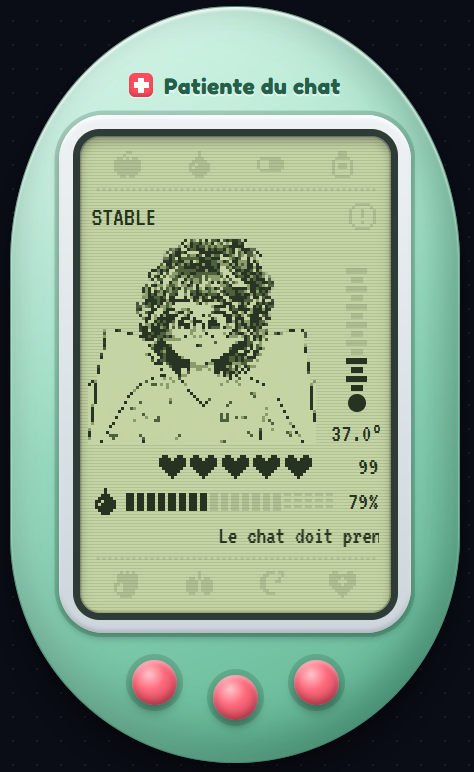

# 🏥 Patiente du chat

Mini-jeu Twitch sous forme de **widget personnalisé StreamElements** : les viewers soignent une patiente virtuelle en tapant des commandes dans le chat. Ils doivent la garder en vie en surveillant sa santé, son hydratation et sa température, et réagir aux urgences (étouffement, arrêt cardiaque…).

<p align="center">
    
</p>

Le widget affiche :

- une image qui change selon l'état de la patiente ;
- un thermomètre gradué de 35 à 42 °C, à droite de l'image ;
- le statut sur un bracelet d'identification (vert, orange, rouge ou bleu) posé sur la photo ;
- l'écran d'un moniteur de chevet avec :
  - la **Santé** sous forme d'onde cardiaque animée : verte et régulière en bonne santé, orange et plus rapide à 60 PV ou moins, rouge, rapide et irrégulière à 30 PV ou moins, et plate pendant un arrêt cardiaque ;
  - l'**Hydratation** sous forme de 20 cases du quadrillage de l'écran, une par tranche de 10 % jusqu'à 200 %. Les cases allumées sont bleues, rouges et clignotantes à 25 % ou moins, et violettes pendant l'anasarque. Les 5 dernières cases (au-delà de 150 %) restent teintées de violet pour signaler la zone de danger ;
- une feuille de soins sur porte-bloc avec les 3 derniers événements.

Le style est celui d'un hôpital cartoon : mur vert menthe, plaque du service avec croix rouge, électrocardiogramme qui défile, photo fixée au sparadrap, contours épais et ombres nettes. Le moniteur et le thermomètre gardent un style de HUD de jeu vidéo. Les polices [Fredoka](https://fonts.google.com/specimen/Fredoka) et [Barlow Condensed](https://fonts.google.com/specimen/Barlow+Condensed) sont chargées depuis Google Fonts.

## Installation dans StreamElements

1. Dans le tableau de bord StreamElements, ouvrez **Overlays** et créez (ou modifiez) un overlay.
2. Ajoutez un widget **Static / Custom → Custom widget**.
3. Cliquez sur **Open editor**, puis collez le contenu de chaque fichier dans l'onglet correspondant :

   | Fichier   | Onglet de l'éditeur |
   |-----------|---------------------|
   | `so.html` | HTML                |
   | `so.css`  | CSS                 |
   | `so.js`   | JS                  |

4. Enregistrez et ajoutez l'overlay comme source navigateur dans OBS.

Le widget fait 320 px de large.

## Commandes du chat

Les commandes ne tiennent pas compte des majuscules, des accents ni de la ponctuation qui suit la commande : `!Réveiller !` fonctionne comme `!reveiller`, et `!eau, stp` comme `!eau`. Seul le premier mot du message est lu.

### Nourriture

| Commande      | Alias                                                                                                  | Effet   |
|---------------|--------------------------------------------------------------------------------------------------------|---------|
| `!manger`     | `!repas` `!nourrir` `!nourriture` `!miam` `!mange`                                                     | +5 PV   |
| `!sandwich`   | `!sandwitch` `!sandwiche`                                                                              | +10 PV  |
| `!cacahuetes` | `!cacahuete` `!cacahouete` `!cacahouetes` `!cacahuette` `!cacahuettes` `!arachide` `!arachides` `!peanut` `!peanuts` | +3 PV   |

⚠️ Chaque repas a **1 chance sur 15** de provoquer un étouffement à la place du gain de PV. Impossible de manger pendant un arrêt cardiaque, un étouffement ou une intubation.

### Hydratation et soins

| Commande     | Alias                                                             | Effet                       | Conditions                                    |
|--------------|-------------------------------------------------------------------|-----------------------------|-----------------------------------------------|
| `!eau`       | `!boire` `!hydrater` `!hydratation`                               | +20 hydratation             | Pas en arrêt, pas d'étouffement, pas intubée  |
| `!perfusion` | `!perf`                                                           | +20 hydratation             | Patiente intubée, pas en arrêt                |
| `!lasilix`   | `!lasix` `!diuretique` `!diuretik` `!diurese`                     | −20 hydratation             | Pas en arrêt                                  |
| `!doliprane` | `!doli` `!paracetamol` `!paracetaml`                              | −1,5 °C (pas sous 36 °C)    | Pas en arrêt                                  |
| `!creme`     | `!cream` `!antihistaminique` `!antihistaminik` `!soignereruption` | Soigne l'éruption cutanée   | Pas en arrêt, éruption présente               |

### Urgences et réanimation

| Commande     | Alias                                                                    | Effet                                    | Conditions                                         |
|--------------|--------------------------------------------------------------------------|------------------------------------------|----------------------------------------------------|
| `!heimlich`  | `!heimlik` `!claque` `!deboucher` `!desobstruer` `!etouffement` `!etouffe` | Stoppe l'étouffement, +15 PV             | La patiente s'étouffe, pas en arrêt                |
| `!intuber`   | `!intubation` `!intube` `!intubee` `!tube`                               | Intube la patiente                       | Moins de 40 PV, pas en arrêt ni en étouffement     |
| `!hypnovel`  | `!sedater` `!sedate` `!sedation` `!endormir` `!dormir` `!hypno`          | Sédate la patiente : +2 PV par tour, elle n'arrache plus son tube, mais 1 risque sur 5 d'arrêt cardiaque | Patiente intubée                                   |
| `!reveiller` | `!reveil` `!reveile` `!reveille` `!reveillee` `!stopsedation`            | Arrête la sédation                       | Patiente sédatée depuis au moins 30 s              |
| `!extuber`   | `!extubation` `!extube` `!retirertube` `!retirertuyau`                   | Retire le tube                           | Intubée, réveillée, au moins 50 PV                 |
| `!mace`      | `!cpr` `!massage` `!reanimer` `!reanimation` `!massagecardiaque` `!rcr`  | Met fin à l'arrêt cardiaque              | Patiente en arrêt cardiaque, 3 viewers différents  |

La réanimation demande **3 `!mace` de viewers différents** en moins de 60 secondes (un même viewer ne compte qu'une fois), sinon la patiente meurt : voir [Arrêt cardiaque et décès](#arrêt-cardiaque-et-décès). Elle stoppe aussi l'étouffement, remonte les PV et l'hydratation à au moins 30, et ramène la température entre 37 et 38 °C.

### Recharges et surdosage

Pour éviter le spam, certains soins ont une recharge commune à tout le chat : tant qu'elle court, la commande est ignorée. Le premier viewer refusé voit le temps restant dans le journal.

| Soin        | Commandes                             | Recharge |
|-------------|---------------------------------------|----------|
| Nourriture  | `!manger` `!sandwich` `!cacahuetes`   | 20 s     |
| Eau         | `!eau` `!perfusion`                   | 20 s     |
| Paracétamol | `!doliprane`                          | 30 s     |
| Diurétique  | `!lasilix`                            | 30 s     |
| Réveil      | `!reveiller`                          | 30 s après chaque `!hypnovel` |

La 3ᵉ dose de paracétamol en moins de 2 minutes est un **surdosage** : la patiente perd 10 PV.

## Règles du jeu

### Constantes

| Constante    | Départ | Limites      |
|--------------|--------|--------------|
| Santé (PV)   | 100    | 0 – 100      |
| Hydratation  | 80 %   | 0 – 200 %    |
| Température  | 37 °C  | 30 – 45 °C   |

### Évolution automatique (toutes les 15 secondes)

- L'hydratation baisse de 1, et de 1 de plus si la patiente est sédatée. En hyperthermie (39 °C ou plus), elle baisse en plus d'autant de points que la fièvre fait perdre de PV (voir l'aggravation ci-dessous).
- La patiente perd 1 PV. Si elle est intubée, elle en regagne 1 à la place, ou 2 si elle est sédatée.
- La température revient vers 37 °C de 0,1 °C.
- En cas d'étouffement, il y a 30 % de risque d'arrêt cardiaque.
- Intubée mais éveillée, elle a 10 % de risque de s'agiter et d'arracher son tube : elle est extubée et perd 10 PV.
- Chaque problème non soigné lui fait perdre des PV en plus : fièvre (38 °C ou plus), éruption cutanée, anasarque, hydratation à 25 % ou moins. Voir [Aggravation des problèmes](#aggravation-des-problèmes).
- À 0 PV, la patiente fait un arrêt cardiaque.
- Il y a 2 % de chance qu'une éruption cutanée apparaisse.
- Sous 38 °C, il y a 3 % de chance d'une poussée de fièvre (+2,5 °C).

Pendant un arrêt cardiaque, l'évolution est figée jusqu'à la réanimation ou au décès.

### Aggravation des problèmes

Plus un problème tarde à être soigné, plus il coûte cher. Il fait perdre 1 PV au premier tour, puis 1 PV de plus toutes les 30 secondes (2 tours), jusqu'à **10 PV par tour** :

| Durée sans soin | 15 s | 30 s | 45 s | 1 min | 1 min 15 | … | 2 min 15 | … | 4 min 45 et plus |
|-----------------|------|------|------|-------|----------|---|----------|---|------------------|
| PV perdus       | 1    | 1    | 2    | 2     | 3        | … | 5        | … | 10               |

- À 0 % d'hydratation, la déshydratation part de 3 PV au lieu de 1.
- En hyperthermie (39 °C ou plus), la fièvre fait aussi perdre autant d'hydratation que de PV.
- Les problèmes se cumulent : une fièvre et une éruption négligées coûtent chacune leur part.
- Le journal prévient quand un problème atteint 5 puis 10 PV par tour.
- Dès qu'un problème est soigné, son compteur repart de zéro. Une fièvre ne compte comme soignée que sous 38 °C.

### Arrêt cardiaque et décès

À l'arrêt cardiaque, le chat a **60 secondes** pour réanimer la patiente avec 3 `!mace` de viewers différents. Le statut affiche le nombre de massages et le temps restant.

Sans réanimation à temps, la patiente meurt : le journal indique combien de temps elle a été soignée et le record. Une nouvelle patiente arrive 30 secondes plus tard ; les commandes sont ignorées d'ici là.

Le record est gardé par le navigateur de la source OBS. Il repart de zéro si ce stockage n'est pas disponible.

### Intubation

Une patiente intubée ne peut ni manger ni boire : il faut l'hydrater avec `!perfusion`, qui lui est réservée. Elle regagne 1 PV toutes les 15 secondes et peut être extubée une fois réveillée et remontée à 50 PV.

Éveillée, elle risque à chaque tour d'arracher son tube (10 %, −10 PV). La sédater avec `!hypnovel` l'en empêche, et elle regagne 2 PV par tour au lieu de 1, mais c'est un pari :

- à chaque `!hypnovel`, il y a **1 risque sur 5** qu'elle réagisse au produit et fasse un arrêt cardiaque ;
- une fois sédatée, elle ne peut pas être réveillée pendant **30 secondes** ;
- sédatée, elle se déshydrate deux fois plus vite.

Une fois à 50 PV, `!reveiller` puis `!extuber`.

### Anasarque (surcharge hydrique)

L'anasarque apparaît quand l'hydratation atteint **150 %** et ne disparaît que lorsqu'elle redescend à **120 %** ou moins. Sur le moniteur, la 15ᵉ case marque ce seuil.

### Statut affiché

Quand plusieurs problèmes se cumulent, le widget affiche le plus grave, dans cet ordre :

| Priorité | Condition                          | Statut                    | Couleur |
|----------|------------------------------------|---------------------------|---------|
| 0        | Décès                              | 💀 DÉCÉDÉE — nouvelle patiente dans 30 s | Rouge   |
| 1        | Arrêt cardiaque                    | 🚨 ARRÊT CARDIAQUE — !mace 1/3 · 45 s    | Rouge   |
| 2        | Étouffement                        | 😱 ÉTOUFFEMENT — !heimlich | Rouge   |
| 3        | Intubée et sédatée                 | 😴 Intubée et sédatée     | Orange  |
| 3        | Intubée                            | 🫁 Intubée et éveillée    | Orange  |
| 4        | PV ≤ 30                            | 🩺 État critique          | Rouge   |
| 5        | Hydratation ≥ 150 %                | 💧 ANASARQUE              | Bleu    |
| 6        | Température ≥ 39 °C                | 🌡️ HYPERTHERMIE           | Rouge   |
| 7        | Hydratation ≤ 25 %                 | 💧 DÉSHYDRATATION         | Orange  |
| 8        | Éruption cutanée                   | 🔴 Éruption cutanée       | Orange  |
| 8        | Hydratation ≤ 50 %                 | 💧 Déshydratée            | Orange  |
| 8        | PV ≤ 60 ou température ≥ 38 °C     | 🤒 Patiente malade        | Orange  |
| —        | Aucun problème                     | Stable                    | Vert    |

## Personnalisation

Tout se règle en haut de `so.js` :

- `IMAGES` : URL de l'image pour chaque état. Pour changer une image, téléversez-la dans StreamElements et remplacez l'URL.
- `HYDRO_MAX` : hydratation maximale (200).
- `HYDRO_CASE` : pourcentage d'hydratation représenté par une case du moniteur (10). Avec un autre réglage, il faudra adapter la largeur du moniteur, qui contient 20 cases de 12 px.
- `ANASARQUE_SEUIL` / `ANASARQUE_SORTIE` : seuils d'apparition (150) et de disparition (120) de l'anasarque.
- `THERMO_MIN` / `THERMO_MAX` : graduations basse (35) et haute (42) du thermomètre.
- `WAVE_SPEED` / `WAVE_GAP` / `WAVE_FADE` : vitesse de l'onde cardiaque (80 px/s), largeur du trou devant le point d'écriture (40 px) et longueur du fondu de l'ancien tracé (15 px).
- `ARRET_DELAI` : secondes laissées au chat pour réanimer la patiente avant le décès (60).
- `MACE_REQUIS` : nombre de viewers différents qui doivent taper `!mace` (3). Avec 1, un seul suffit.
- `DECES_DUREE` : secondes avant l'arrivée d'une nouvelle patiente (30).
- `RECHARGES` : recharge de chaque soin, en secondes (nourriture et eau 20, paracétamol et diurétique 30). `reveil` est le délai avant de pouvoir réveiller une patiente qu'on vient de sédater (30).
- `SURDOSE_DOSES` / `SURDOSE_FENETRE` / `SURDOSE_PV` : 3 doses de paracétamol en 120 secondes font perdre 10 PV.
- `AGGRAVATION_TOURS` / `AGGRAVATION_MAX` : un problème non soigné coûte 1 PV de plus tous les 2 tours, jusqu'à 10 PV par tour.
- `AGITATION_RISQUE` / `AGITATION_PV` : une patiente intubée éveillée a 10 % de risque par tour d'arracher son tube, et perd alors 10 PV.
- `SEDATION_RISQUE` : risque d'arrêt cardiaque à chaque `!hypnovel` (0,2, soit 1 sur 5).
- `COMMANDS` : liste des commandes et de leurs alias.

La fréquence de l'évolution automatique est fixée à la fin du fichier : `setInterval(gameTick, 15000)` (en millisecondes). Juste en dessous, `setInterval(clockTick, 1000)` fait avancer l'horloge de jeu, qui compte les secondes des recharges, de la réanimation et de la survie.

## Atelier : Clone n°3 de Sophie (simulateur local)

L'atelier fait tourner le vrai widget (`so.html`, `so.css`, `so.js`) dans le navigateur, sans StreamElements ni Twitch. Il faut Node.js, sans aucune dépendance à installer :

```
node atelier/serveur.js
```

Ouvrez ensuite http://localhost:3003/ (pour changer de port : `PORT=3004 node atelier/serveur.js`).

L'atelier permet de :

- **simuler le chat** : envoyer n'importe quel message sous un pseudo choisi, ou cliquer sur une commande, éventuellement plusieurs fois de suite. Chaque répétition vient d'un viewer différent (Viewer, Viewer 2…), ce qui permet de tester la réanimation à plusieurs ;
- **modifier chaque paramètre** en direct : curseurs pour la santé, l'hydratation, la température et les secondes restantes pour réanimer, interrupteurs pour l'anasarque, l'éruption, l'étouffement, l'intubation, la sédation, l'arrêt cardiaque et le décès. Comme l'anasarque dépend de l'hydratation, l'activer porte l'hydratation à 150 % et la désactiver la ramène à 120 %, si besoin ;
- **contrôler le temps** : pause, vitesse ×1 à ×100, avance d'un ou dix tours de 15 secondes. Les recharges et le délai de réanimation suivent ce temps simulé ;
- **forcer le hasard** : tout déclencher (étouffement en mangeant, éruption, fièvre, tube arraché, arrêt à la sédation…) ou rien ;
- **charger un scénario** : intubée à 35 PV, poussée de fièvre, bord de l'anasarque, arrêt cardiaque, arrêt à 10 secondes du décès… ;
- **suivre un journal complet** : messages du chat, messages du widget, changements de statut et erreurs JavaScript avec leur ligne dans `so.js`.

Les commandes et les paramètres sont lus directement dans `so.js` : un alias ou un champ ajouté apparaît automatiquement. Le widget se recharge tout seul dès qu'un des trois fichiers est enregistré.

## Tester sans le chat

Le widget réagit à l'événement StreamElements `onEventReceived`. Pour simuler un message, ouvrez la console du navigateur sur la page où tourne le widget (en sélectionnant le cadre du widget si besoin) et lancez :

```js
window.dispatchEvent(new CustomEvent("onEventReceived", {
  detail: {
    listener: "message",
    event: { data: { text: "!eau", displayName: "Testeur" } }
  }
}));
```

## Structure du projet

```
so.html   Structure du widget (image, thermomètre, bracelet, moniteur, journal)
so.css    Apparence du widget
so.js     Logique du jeu, commandes du chat et mise à jour de l'affichage
atelier/  Simulateur local « Atelier : Clone n°3 de Sophie »
  serveur.js    Serveur local (node atelier/serveur.js)
  index.html    Page du simulateur
  atelier.css   Apparence du simulateur
  atelier.js    Pilotage du widget : chat, paramètres, temps, hasard, journal
```
